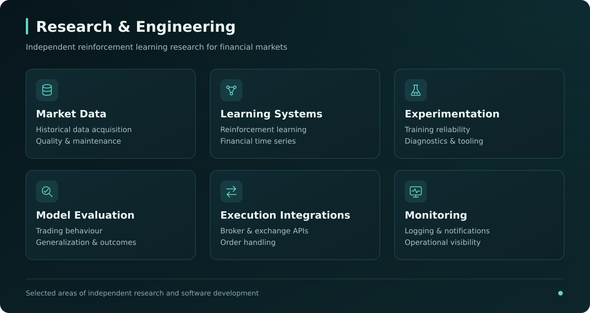

# RL BTC Trading Agent 🚀

An independent reinforcement learning project for systematic trading, developed over nearly two years. Originally focused on Bitcoin, it has grown into research across multiple financial assets, combining quantitative research, machine learning, and trading infrastructure.

I own the project's research and engineering: market-data pipelines, the trading environment, model development, evaluation, and execution tooling. This repository showcases selected infrastructure and examples from the project; the current research implementation remains private.

  

## 👨‍💻 Research & Engineering Ownership
- Designed and developed the project independently, from initial research to execution prototypes.
- Built market-data pipelines, training infrastructure, evaluation tools, and trading integrations.
- Investigated model behavior, training stability, data quality, and generalization.
- Developed logging and monitoring tools to connect research experiments with observable trading behavior.

## 📍 Current Status — November 2026
Research and validation are ongoing, with positive validation results across four assets. Current work focuses on further evaluation, broader asset coverage, and preparation for live deployment.

**Public showcase.** The overview below presents the project's research and engineering scope. Existing screenshots illustrate the public research snapshot; the current research implementation remains private.

## 🌟 Technical Innovations
- **Custom RL Research**: Designed a financial research environment and developed learning-based approaches to trading decisions.
- **Financial Time-Series Modelling**: Investigated neural methods for learning from market data, including temporal convolutional networks (TCNs).
- **Reliable Experimentation**: Built GPU-based training workflows with attention to stability, memory efficiency, and recovery from interruptions.
- **Evaluation & Diagnostics**: Developed tools to investigate model behaviour, generalization, and financial outcomes.
- **Research-to-Execution Engineering**: Built supporting software for data acquisition, experiments, broker integrations, and monitoring.

**Technology experience:** Python · PyTorch · Stable-Baselines3 · PPO · TCN · TensorBoard.

  
*Selected areas of independent research and engineering.*

## 🛠️ Infrastructure
- **Market Data**: API-based acquisition and maintenance of historical financial data.
- **Execution Integrations**: Broker and exchange connectivity through Bybit and MetaTrader 5.
- **Research Tooling**: Software supporting quantitative experiments and the analysis of trading behaviour.
- **Operational Monitoring**: Trade notifications, logging, and diagnostic tooling.

  
*Trading research example from the public snapshot.*

  
*Trade execution notification from the public prototype.*

## 🧠 Challenges Overcome
- Addressed training instability through gradient diagnostics and optimization.
- Designed a proprietary reward function and investigated its effect on trading behavior.
- Investigated overfitting risks and evaluated model behavior on out-of-sample data.
- Built and maintained the data, logging, and analysis tools needed for sustained research experiments.

## 📁 Repository Contents
- `get_last_candles.py`: Fetches Bybit candles.
- `trade_mt5.py`/`trade_on_bybit.py`: Public execution-infrastructure examples for MT5/Bybit.
- `images/`:
  - `wallpaper-rl-math-v2.png`: Project cover illustration.
  - `research-overview.svg`: Overview of the project's research and engineering areas.
  - `reward.png`, `networth_drawdown_winrate.png`, `trading_metrics.png`: Research-metric screenshots.
  - `strategy1.png`, `strategy2.png`: TradingView examples.
  - `telegram_notifications.png`: Telegram trade notification.

## 📈 Research & Evaluation
Evaluation covers trading outcomes, drawdowns, model behavior, and generalization across market conditions. Trade logs and experiment metrics support the investigation of changes in model performance and behavior.

The repository's existing charts and examples illustrate the public research snapshot. The current multi-asset research status is summarized under **Current Status**.

## 🚀 Next Steps
- Continue evaluation across multiple financial assets.
- Develop portfolio-level diversification and risk allocation.
- Advance execution tooling and preparation for live deployment.

## 🤝 Research & Collaboration
For quantitative research, ML engineering, and trading-infrastructure collaborations:

[GitHub](https://github.com/Tim1l) · [LinkedIn](https://www.linkedin.com/in/tim-izmailov-a53524283/) · [Upwork](https://www.upwork.com/freelancers/~01d554f7011bd884f2)

## 🙌 Acknowledgments
- Built with PyTorch, Stable-Baselines3.
- Inspired by quant trading community.
- Feedback welcome via issues!

## License
MIT License (see `LICENSE`).
