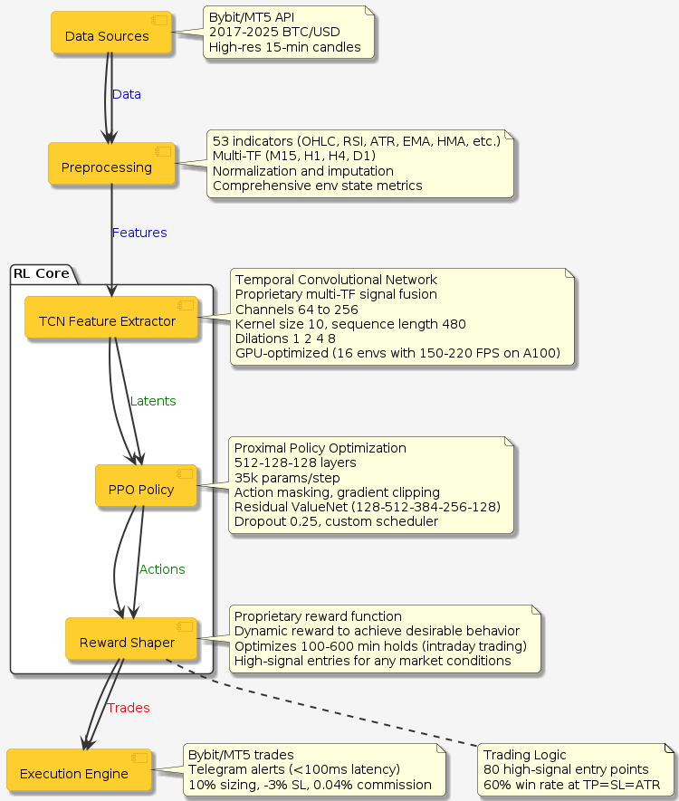
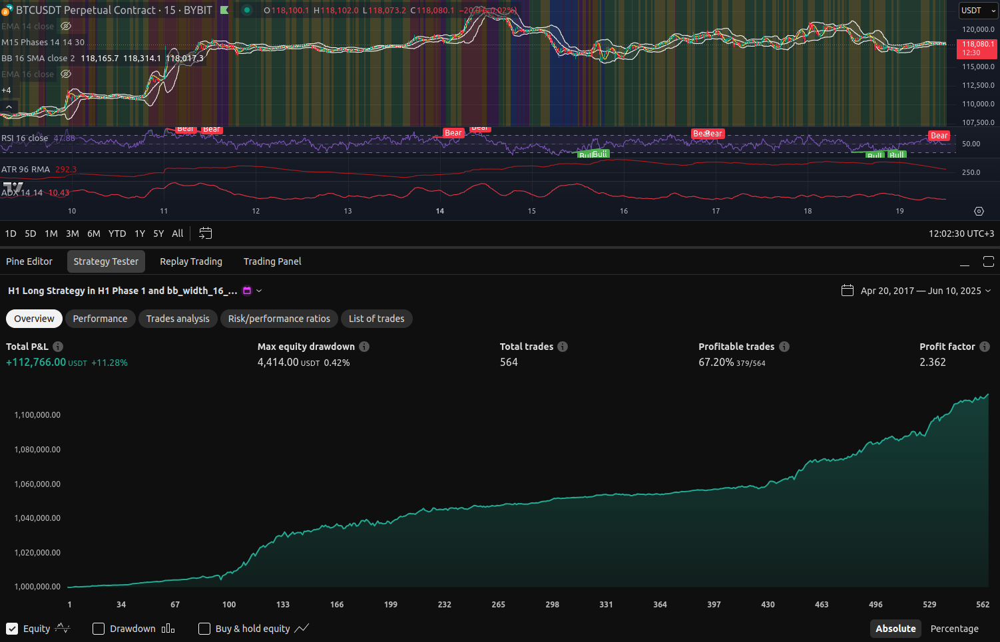
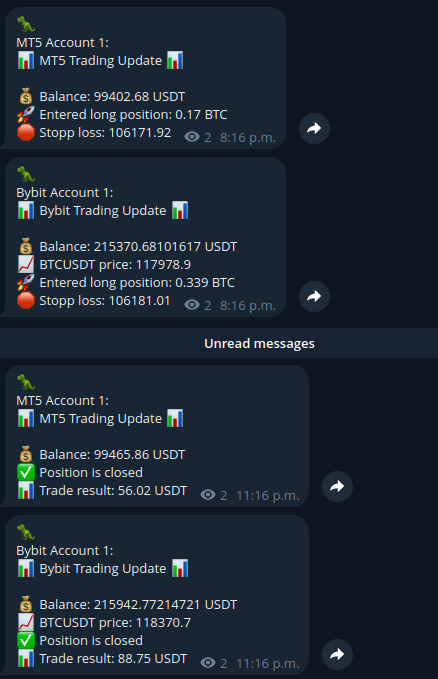

# RL BTC Trading Agent 🚀

An independent reinforcement learning project for systematic trading, developed over nearly two years. Originally focused on Bitcoin, it has grown into research across multiple financial assets, combining quantitative research, machine learning, and trading infrastructure.

I own the project's research and engineering: market-data pipelines, the trading environment, model development, evaluation, and execution tooling. This repository showcases selected infrastructure and examples from the project; the current research implementation remains private.

  

## 👨‍💻 Research & Engineering Ownership
- Designed and developed the project independently, from initial research to execution prototypes.
- Built market-data pipelines, training infrastructure, evaluation tools, and trading integrations.
- Investigated model behavior, training stability, data quality, and generalization.
- Developed logging and monitoring tools to connect research experiments with observable trading behavior.

## 📍 Current Status — November 2026
Research and validation are ongoing, with positive validation results across four assets. Current work focuses on further evaluation, broader asset coverage, and preparation for live deployment.

**Public research snapshot.** The technical descriptions, figures, and examples below document the version represented in this repository. The project's current research stage is described separately above.

## 🌟 Technical Innovations
- **Custom RL Environment**: PPO-based with action masking, processing 35,000+ parameters/step across M15, H1, H4, D1 timeframes.
- **Feature Extraction**: Temporal Convolutional Network (TCN) with 64-256 channels, dilations [1,2,4,8], and sequence length 480, capturing multi-TF dynamics.
- **Policy Network**: 512-128-128 layers, enhanced by gradient hooks for stability and anti-overfitting design.
- **Value Network**: Residual connections (128-512-384-256-128), layer normalization, and dropout (0.25) for robust value estimation.
- **Reward Function**: Proprietary, optimizes 100-600 min holds, balances long/short entries, and prioritizes high-signal trades (80 entry points with 60% win rate at TP=SL=ATR).
- **Observations**: Comprehensive state with 53 indicators (OHLC, RSI, ATR, EMA, HMA) and environment metrics, fully normalized.
- **Compute**: GPU-optimized, achieving 150-220 FPS on A100 across 16 parallel environments.

  
*High-level pipeline: Data → TCN → PPO → Execution.*

## 🛠️ Infrastructure
- **Data Pipeline**: Fetches high-res BTC/USD candles (2017-2025) via Bybit/MT5 APIs, with advanced normalization and imputation (`get_last_candles.py`).
- **Execution**: Seamless Bybit/MT5 integration with optimized low-latency execution, 10% position sizing, -3% stop-loss, 0.04% commission (`trade_on_bybit.py`, `trade_mt5.py`).
- **Trading Logic**: 80 high-signal entry points derived from market patterns, achieving 60% win rate at TP(ATR) = SL(ATR).
- **Monitoring**: Trade logging and signal analysis, illustrated by the public screenshots.

  
*Example of high-signal entry (anonymized, win rate >60%).*

  
*Telegram notification for trade execution.*

## 🧠 Challenges Overcome
- Addressed training instability through gradient diagnostics and optimization.
- Designed a proprietary reward function and investigated its effect on trading behavior.
- Investigated overfitting risks and evaluated model behavior on out-of-sample data.
- Built and maintained the data, logging, and analysis tools needed for sustained research experiments.

## 📁 Repository Contents
- `get_last_candles.py`: Fetches Bybit candles.
- `trade_mt5.py`/`trade_on_bybit.py`: Public execution-infrastructure examples for MT5/Bybit.
- `images/`:
  - `wallpaper-rl-math-v2.png`: Project cover illustration.
  - `architecture.png`: Architecture illustration from the public research snapshot.
  - `reward.png`, `networth_drawdown_winrate.png`, `trading_metrics.png`: Research-metric screenshots.
  - `strategy1.png`, `strategy2.png`: TradingView examples.
  - `telegram_notifications.png`: Telegram trade notification.

## 📈 Research & Evaluation
Evaluation covers trading outcomes, drawdowns, model behavior, and generalization across market conditions. Trade logs and experiment metrics support the investigation of changes in model performance and behavior.

The repository's existing charts and examples illustrate the public research snapshot. The current multi-asset research status is summarized under **Current Status**.

## 🚀 Next Steps
- Continue evaluation across multiple financial assets.
- Develop portfolio-level diversification and risk allocation.
- Advance execution tooling and preparation for live deployment.

## 🤝 Research & Collaboration
For quantitative research, ML engineering, and trading-infrastructure collaborations:

[GitHub](https://github.com/Tim1l) · [LinkedIn](https://www.linkedin.com/in/tim-izmailov-a53524283/) · [Upwork](https://www.upwork.com/freelancers/~01d554f7011bd884f2)

## 🙌 Acknowledgments
- Built with PyTorch, Stable-Baselines3.
- Inspired by quant trading community.
- Feedback welcome via issues!

## License
MIT License (see `LICENSE`).
